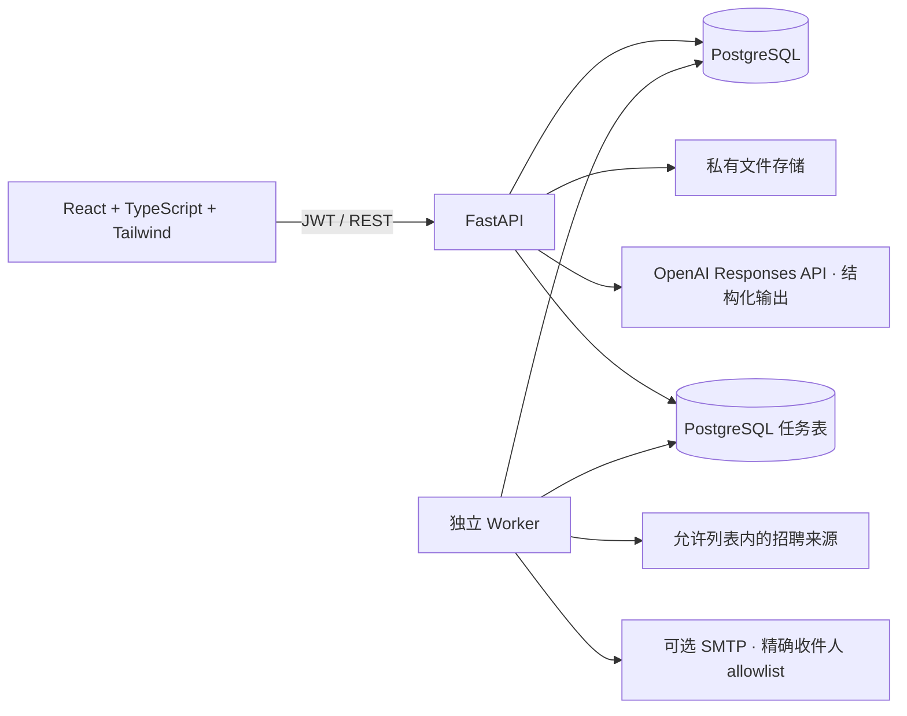

# AI Career Agent · AI 求职智能助手

面向大学生、应届生与求职者的求职工作台：导入岗位、用真实经历分析匹配度、生成岗位专属简历、准备面试沟通，并追踪投递过程。个人经历以用户确认的事实为来源；AI 可以改善表达，不能把兴趣包装成任职经历，也不能添加没有依据的结果或数字。

> 每日任务可将处理目标设为最多 1,000 个岗位条目。该数值是队列目标，不代表 1,000 份申请已被招聘方接收。BOSS、微信公众号和小程序没有本项目获准的通用自动投递连接器。系统将材料准备、发送尝试、SMTP 服务器受理与申请确认分别记录。

## 功能

- **经历资料**：PDF、DOCX、TXT 上传与文本提取；工作、项目、教育、技能、兴趣和成果事实分类；事实确认和修订历史。
- **岗位管理**：粘贴 JD、人工录入、CSV/XLSX 批量导入；保存公司、地点、行业、薪资、来源、链接、发布时间和截止时间。AI 可从用户粘贴的招聘公告中结构化提取岗位。
- **岗位匹配**：逐项显示 JD 要求、事实证据、缺口和建议；分数是加权证据覆盖度，不是录用概率。
- **岗位简历**：中文/英文岗位版本、事实引用、JSON 编辑、不可变版本、独立 AI 事实核查、人工批准，以及 PDF、DOCX、TXT 导出。
- **求职教练**：多轮 AI 对话；对简历、面试回答、HR 回复逐条分析“哪里不好、原因、如何改”；生成 BOSS 开场白、邮件、LinkedIn、微信和 follow-up 草稿。
- **求职信息库**：添加网站、RSS、飞书表格、招聘表格、公众号、小程序和邮件来源；提供求职方舟、OfferShow、牛客汇总、牛客校招日程、飞书与腾讯表格的入口目录。来源登记不代表已取得平台授权或已同步内容；CSV/XLSX 可直接导入。
- **投递看板**：待投递、已投递、HR 沟通、一面、二面、Offer、拒绝和撤回；保存 HR 联系方式、简历版本与状态时间线。
- **自动化**：每日定时策略、最多 1,000 条目标、筛选条件、来源同步、持久任务队列、暂停/恢复、租约和幂等控制。默认只准备材料。

## 系统架构



PostgreSQL 的任务表提供持久队列和 `SKIP LOCKED` 多 Worker 领取；租约、心跳、幂等键与未知发送结果处理降低重复执行风险。开发环境支持 SQLite 单 Worker。表结构和约束由 Alembic 管理，数据库结构概览见 [`database/schema.md`](database/schema.md)，接口与证据约定见 [`docs/implementation-contract.md`](docs/implementation-contract.md)。

## 本地启动（Windows PowerShell）

需要 Python 3.12+、Node.js 24+、pnpm 11 和 Git。项目提供脚本生成开发 JWT/数据库密钥、迁移数据库并在后台启动 API、Worker 和前端：

```powershell
.
scripts\configure.py
```

`configure.py` 是 Python 脚本，请这样运行：

```powershell
python scripts\configure.py
```

随后：

```powershell
.
scripts\start-local.ps1
```

打开 <http://127.0.0.1:5173>。本机需要可用的 Python/Node 命令。停止服务：

```powershell
.
scripts\stop-local.ps1
```

也可用 Docker Compose 启动 PostgreSQL、API、Worker 和 Nginx 前端：

```powershell
python scripts\configure.py
docker compose up --build
```

应用入口为 <http://127.0.0.1:8080>。本地开发默认使用 SQLite；生产部署必须配置 PostgreSQL、HTTPS、强随机 `JWT_SECRET`、私有持久文件卷、数据库备份与 CORS 来源。

### 配置 AI

首次运行后编辑根目录 `.env` 或 `backend/.env`，设置：

```dotenv
OPENAI_API_KEY=你的服务端密钥
OPENAI_MODEL=gpt-4.1-mini
# 如使用兼容服务，可填写 OPENAI_BASE_URL
```

密钥只保存在服务端环境，不提交 Git。没有密钥时，资料管理仍可用，AI API 会返回明确的配置错误，不会返回伪造结果。AI 请求使用结构化 schema、限时、有限并发和不自动重试；调用记录保留输入摘要而不在运行日志存储完整简历正文。

### 可选邮件发送

SMTP 默认关闭。只有获得招聘邮箱和邮件服务授权后，才设置 `EMAIL_SUBMIT_ENABLED=true`、SMTP 凭证和 `SMTP_RECIPIENT_ALLOWLIST` 精确地址列表，并在策略中开启发送。系统发送前仍核对事实和人工批准。SMTP `mail_accepted` 只说明邮件服务器接受了邮件，不能证明 HR 或招聘系统已收到。

## 用户流程

1. 注册账户，在个人资料页填写联系方式与目标方向。
2. 上传已有简历，或手动添加教育、工作、项目和兴趣事实，逐条确认。
3. 添加招聘来源、粘贴 JD，或导入 CSV/XLSX。职位只有具备完整 JD 才进入每日准备队列。
4. 查看匹配报告；针对缺失经历，补充真实材料或制定提升建议。
5. 生成岗位版本，审阅事实引用，通过独立事实核查后批准并导出。
6. 创建投递记录，更新 HR、面试与 Offer 状态；用教练复盘回答并生成跟进草稿。
7. 创建每日策略。Worker 根据岗位和个人事实准备材料；平台支持的外部发送必须另行配置。

## API 入口

OpenAPI 文档在 API 启动后访问 <http://127.0.0.1:8000/docs>。主要路由：

| 路由 | 用途 |
|---|---|
| `/api/v1/auth/register`, `/login`, `/me` | JWT 用户认证 |
| `/api/v1/documents`, `/facts`, `/profile` | 文件、事实和个人资料 |
| `/api/v1/sources`, `/sources/catalog`, `/sources/{id}/sync` | 渠道登记与来源同步任务 |
| `/api/v1/jobs`, `/jobs/import` | 岗位录入和表格导入 |
| `/api/v1/ai/chat`, `/review`, `/draft`, `/extract-jobs`, `/match`, `/tailor`, `/validate-resume` | 结构化 AI 功能 |
| `/api/v1/resumes`, `/applications` | 简历版本、导出、投递跟踪 |
| `/api/v1/automation/policies`, `/run`, `/batches`, `/tasks` | 每日策略、批次与任务 |

## 验证

```powershell
cd backend
python -m alembic upgrade head
python -m alembic check
python -m ruff check app tests
python -m pytest -q
cd ..\frontend
pnpm install --frozen-lockfile
pnpm build
```

GitHub Actions 在 PostgreSQL 17 上执行迁移、漂移检查和后端测试，并构建前端。测试状态见 [`docs/testing.md`](docs/testing.md)。

## 项目结构

```text
frontend/             React、TypeScript、Tailwind 工作台
backend/app/          FastAPI、AI 服务、来源连接器、队列 Worker
backend/alembic/      PostgreSQL/SQLite 数据库迁移
database/             SQL 模型概览
docs/                 产品、架构、接口、测试与面试说明
scripts/              本地配置与启动脚本
compose.yaml          PostgreSQL、API、Worker、Nginx
```

## 求职简历项目描述

**中文：** 设计并实现 AI 求职助手，使用 React/TypeScript、FastAPI、PostgreSQL 与 OpenAI 结构化输出，支持岗位解析、证据型匹配、基于已确认经历的简历定制、面试沟通辅导和投递跟踪。通过不可变事实快照、简历主张证据引用、AI 语义复核及邮件回执分级，控制内容真实性与重复投递风险。

**English:** Developed an AI-powered career assistant platform that analyzes job descriptions, optimizes resumes against user-confirmed experience, manages applications, and provides AI interview coaching. Built with React, TypeScript, FastAPI, PostgreSQL, and structured OpenAI outputs; added evidence-linked resume versions, durable daily job queues, and auditable application status tracking.

## 灵感与许可

产品流程参考 ResumeForge（简历编辑与模板）、auto-job-apply（岗位匹配与申请管理）及 GeekGeekRun（求职流程工具）的公开设计思路。本仓库代码独立编写，没有复制这些项目的实现。当前仓库使用 MIT License。
